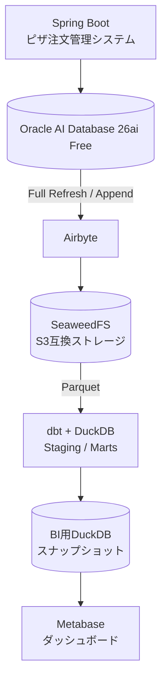

# Pizza Data Platform

Windows 11 PC 1台で、業務システム（OLTP）からデータレイク、データウェアハウス（DWH）、BIまでを構築する、個人学習用のデータマネジメント基盤です。

2026年のQiita Advent Calendar向けハンズオンとして、複数のOSS・無償利用可能な製品を組み合わせ、データの収集・保存・加工・分析、およびデータ更新時の動作を検証しました。

## 1. システム構成



データの流れは次のとおりです。

- **OLTP**：Spring BootとOracleでピザ注文データを管理
- **データ収集**：AirbyteでOracleからデータを取得
- **データレイク**：SeaweedFSにParquet形式でRawデータを保存
- **データ加工・DWH**：dbtとDuckDBでStaging・Martsを構築
- **BI**：Metabaseで注文金額、注文件数、注文数量などを可視化

Spring Bootアプリケーションは別リポジトリで管理しています。

[Spring Pizza Order](https://github.com/t-konishi/spring-pizza-order)

## 2. 検証環境

| 分類 | 使用技術 |
|---|---|
| ホストOS | Windows 11 |
| Linux環境 | WSL2 / Ubuntu |
| コンテナ | Docker Desktop |
| OLTP | Oracle AI Database 26ai Free |
| データ収集 | Airbyte Core 2.4.0 / abctl 0.30.4 |
| オブジェクトストレージ | SeaweedFS 4.48 |
| ファイル形式 | Apache Parquet |
| 分析エンジン | DuckDB 1.5.6 |
| データ変換 | dbt Core 1.12.5 / dbt-duckdb 1.11.0 |
| BI | Metabase（DuckDBドライバー対応イメージ：`ghcr.io/motherduckdb/metabase-duckdb:sha-7b4bd93`） |

検証時のWSL2のメモリは約7.7GiBです。

メモリ容量に制約があるため、Oracle・Airbyteによるデータ収集時とMetabaseによる分析時で、起動するコンテナを切り替えています。すべてのコンポーネントを常時起動する構成ではありません。

## 3. リポジトリ構成

```text
pizza-data-platform/
├── README.md
├── .gitignore
├── dbt/
│   ├── dbt_project.yml
│   ├── profiles.yml
│   └── models/
│       ├── staging/
│       │   ├── stg_customers.sql
│       │   ├── stg_orders.sql
│       │   ├── stg_order_items.sql
│       │   ├── stg_pizzas.sql
│       │   ├── stg_payments.sql
│       │   └── schema.yml
│       └── marts/
│           ├── dim_customers.sql
│           ├── dim_pizzas.sql
│           ├── dim_date.sql
│           ├── fct_sales.sql
│           ├── mart_daily_sales.sql
│           └── schema.yml
└── infra/
    ├── seaweedfs/
    │   ├── compose.yaml
    │   └── .env.example
    ├── dbt/
    │   ├── Dockerfile
    │   └── compose.yaml
    └── metabase/
        └── compose.yaml
```

DuckDBのデータベースファイル、S3認証情報、SeaweedFSのデータ、Metabaseの管理データはGit管理対象に含めていません。

## 4. データソース

Oracleの`PIZZA`スキーマに、次の5テーブルを用意しています。

| テーブル | 用途 |
|---|---|
| CUSTOMERS | 顧客マスター |
| PIZZAS | ピザ商品マスター |
| ORDERS | 注文ヘッダー |
| ORDER_ITEMS | 注文明細 |
| PAYMENTS | 支払情報 |

注文管理アプリケーションからデータを登録し、Airbyteでこれらのテーブルを取得します。

## 5. データレイク

SeaweedFSのS3互換APIを利用し、`pizza-lake`バケットにRawデータを保存します。

Rawデータは次のようなパスにParquet形式で保存されます。

```text
s3://pizza-lake/raw/oracle/PIZZA/ORDERS/*.parquet
```

Airbyteの同期方式は、検証時には`Full refresh | Append`を使用しています。

そのため、再同期すると同じ業務レコードの異なる同期世代がRawに追加されます。Rawをそのまま全件集計すると二重計上が発生するため、dbtのStagingで対象世代を明示的に選択しています。

**注意**：本環境で検証したSeaweedFSとAirbyteの組み合わせでは、`Full refresh | Overwrite`利用時に、同期ジョブが成功と表示されてもParquetが消失する問題が発生しました。このため、本ハンズオンではAppend方式を使用しています。一般的な製品仕様としてOverwriteが常に利用できないという意味ではありません。

## 6. DWH：dbt + DuckDB

dbtでは、次の2層を構築しています。

### Staging

Airbyteで取得したRawデータを読み込み、データ型と列名を統一します。

- `stg_customers`
- `stg_orders`
- `stg_order_items`
- `stg_pizzas`
- `stg_payments`

StagingはDuckDBのVIEWとして構築します。

同期世代は`dbt/dbt_project.yml`の変数で指定します。

```yaml
vars:
  airbyte_generation_id: 3
```

この値は2026年10月の検証時に成功した同期世代を表しており、任意の環境で常に`3`を指定すればよいわけではありません。新しい同期結果を採用する場合は、成功した同期ジョブと世代IDを確認したうえで更新します。

### Marts

分析用のスタースキーマを構築します。

| モデル | 役割 |
|---|---|
| `dim_customers` | 顧客ディメンション |
| `dim_pizzas` | 商品ディメンション |
| `dim_date` | 日付ディメンション |
| `fct_sales` | 注文明細単位のファクト |
| `mart_daily_sales` | 日別集計マート |

MartsはDuckDBの物理テーブルとして構築します。

### DuckDBのスキーマ構成

dbtでは、StagingとMartsをそれぞれ別のDuckDBスキーマに配置しています。

| レイヤー | DuckDBスキーマ | マテリアライズ方式 |
|---|---|---|
| Staging | `analytics_staging` | VIEW |
| Marts | `analytics_marts` | TABLE |

StagingではSeaweedFSに保存されたParquetファイルを参照するVIEWを作成し、Martsでは分析用データをDuckDBの物理テーブルとして保存します。

例えば、日別注文集計マートは次のSQLで参照できます。

```sql
SELECT *
FROM analytics_marts.mart_daily_sales;
```

Martsを物理テーブルとして保持することで、Metabaseから分析する際にはSeaweedFSのRawデータを毎回読み取る必要がありません。

`fct_sales`では、Oracleから取得した`ORDERED_AT`をUTCとして扱い、日本標準時（JST）の日付へ変換します。

```sql
cast(
    (o.ordered_at AT TIME ZONE 'UTC') AT TIME ZONE 'Asia/Tokyo'
    as date
) as order_date
```

本ハンズオンの「注文金額」は注文明細の小計を集計したものであり、決済完了を条件とした確定売上ではありません。

## 7. 実行手順の概要

以下は、OracleとAirbyteの構築・接続設定が完了している環境で、SeaweedFS、dbt、Metabaseを操作する例です。

### 7.1 SeaweedFS

`infra/seaweedfs/.env.example`を参考に、実際の認証情報を設定した`infra/seaweedfs/.env`を用意します。

```bash
cp infra/seaweedfs/.env.example infra/seaweedfs/.env
```

続いて、エディタ(viやVS Codeなど)で編集します。

```bash
vi infra/seaweedfs/.env
```

設定項目は次の3つです。

```
S3_ACCESS_KEY_ID=pizzaadmin
S3_SECRET_ACCESS_KEY=change-me
S3_BUCKET=pizza-lake
```

S3_SECRET_ACCESS_KEYは実際の検証環境に合わせて変更します。

また、dbtのDocker Composeもこの.envを参照するため、SeaweedFSとdbtで同じ認証情報を使用する必要があります。

```bash
docker compose -f infra/seaweedfs/compose.yaml up -d
```

SeaweedFSはポート`8333`でS3互換APIを提供します。

### 7.2 Airbyte

Airbyte Coreは別途`abctl`を用いて導入します。

AirbyteのGUIでOracle SourceとS3 Destinationを設定し、5テーブルを`Full refresh | Append`で同期します。

Airbyteの構築手順と接続設定の自動化ファイルは、このリポジトリには含まれていません。

### 7.3 dbt

DuckDBのデータファイルはGit管理対象外のため、初回実行時に保存先ディレクトリを作成します。

以下のコマンドは、リポジトリのルートディレクトリで実行します。

```bash
mkdir -p duckdb/bi
```

同期完了後、成功した同期世代を確認して`airbyte_generation_id`を設定します。

dbtモデルを実行します。

```bash
docker compose -f infra/dbt/compose.yaml run --rm dbt dbt run
```

データ品質テストを実行します。

```bash
docker compose -f infra/dbt/compose.yaml run --rm dbt dbt test
```

これらのコマンドは、リポジトリのルートディレクトリから実行します。

dbt実行時にはSeaweedFSが起動しており、Dockerネットワーク`pizza-data-net`で接続可能である必要があります。

### 7.4 BI用DuckDBスナップショット

Metabaseは分析用DuckDBのコピーを読み取り専用で利用します。

dbt処理が終了しており、Metabaseが停止した状態で、未反映のWALがないことを確認してから、BI用ファイルを更新します。

```bash
cp -p duckdb/analytics.duckdb duckdb/bi/analytics_bi.duckdb.new && mv -f duckdb/bi/analytics_bi.duckdb.new duckdb/bi/analytics_bi.duckdb
```

既存のBI用ファイルがある場合は、更新前にバックアップします。

### 7.5 Metabase

本環境では、DuckDBドライバーが組み込まれたMetabaseのDockerイメージを使用しています。

使用したイメージは`ghcr.io/motherduckdb/metabase-duckdb:sha-7b4bd93`です。

Metabaseの標準イメージではなく、このDuckDBドライバー対応イメージを採用することで、DuckDBの分析用テーブルをMetabaseから参照しています。

OracleとAirbyteを停止し、メモリに余裕を確保してからMetabaseを起動します。

```bash
docker compose -f infra/metabase/compose.yaml up -d
```

ブラウザから`http://127.0.0.1:3000`へアクセスします。

#### DuckDBとの接続

Metabaseの初期設定後、分析用データベースとしてDuckDBを登録します。

本環境では、BI用DuckDBファイルをコンテナ内の次のパスに読み取り専用でマウントしています。

`/bi/analytics_bi.duckdb`

MetabaseのDuckDBデータベース接続設定では、このファイルを参照します。

#### ダッシュボードの作成

MetabaseのGUIで、以下の6つの質問を使用したピザ注文分析ダッシュボードを作成しました。

- 注文金額合計
- 注文件数
- 注文数量合計
- 日別注文金額の推移
- 日別注文数量の推移
- 商品別注文金額

6つの質問には共通の日付フィルターを設定し、分析期間を変更するとすべての集計結果が更新される構成としています。

DWHを更新した後は、Metabaseを停止し、BI用DuckDBスナップショットを更新してから再起動します。

なお、Metabaseの初期設定、DuckDB接続設定、保存済み質問とダッシュボードの管理データはリポジトリに含まれていません。

本リポジトリには、Metabaseの質問・ダッシュボード定義の自動生成スクリプトも含まれていません。再現する場合はMetabaseのGUIで設定する必要があります。

## 8. データ更新の検証結果

2026年10月に、新規注文を登録してデータ基盤全体の更新処理を検証しました。

追加した注文は次のとおりです。

| 項目 | 内容 |
|---|---|
| 注文ID | 81 |
| 商品 | マルゲリータ |
| 数量 | 2枚 |
| 注文金額 | 2,400円 |
| 注文日（JST） | 2026年10月14日 |

再同期後の検証結果は次のとおりです。

| 項目 | 結果 |
|---|---:|
| Rawの累積レコード数（5テーブル合計） | 51件 |
| 最新同期世代のレコード数（5テーブル合計） | 27件 |
| dbt Stagingモデル | 5 |
| dbt Martsモデル | 5 |
| dbtテスト | 49件PASS |
| 全注文金額 | 28,800円 |
| 全注文件数 | 7件 |
| 全注文数量 | 21枚 |

Airbyteによる再同期では、`Full refresh | Append`方式により、以前の同期世代のデータを残したまま新しいデータが追加されました。

5テーブルのレコード数は次のとおりです。

| Oracleテーブル | Rawの累積件数 | 最新同期世代の件数 |
|---|---:|---:|
| CUSTOMERS | 8 | 4 |
| ORDERS | 13 | 7 |
| ORDER_ITEMS | 15 | 8 |
| PIZZAS | 8 | 4 |
| PAYMENTS | 7 | 4 |
| **合計** | **51** | **27** |

今回の検証では、Airbyteの同期世代`3`に属する27件をdbtのStagingで選択しました。

これにより、過去の同期世代と重複するレコードを集計対象から除外し、Martsで正しい注文金額・注文件数・注文数量を算出できました。

なお、この方式は成功したFull Refreshの同期世代を手動で指定するものであり、CDCによる増分更新や、業務キーに基づく自動的な重複排除を実装したものではありません。

Metabaseでも、追加注文2,400円が2026年10月14日の注文として集計されることを確認しました。

## 9. 制約と注意事項

本リポジトリは個人学習・技術検証の成果物であり、本番運用向けの完成済みデータプラットフォームではありません。

特に次の制約があります。

- Oracle DatabaseのDDL・初期データ、Airbyteの接続設定一式は同梱していません。
- Airbyteの同期は手動実行です。データパイプラインの自動オーケストレーションは実装していません。
- 同期世代はdbt変数で明示的に指定しており、自動選択は行いません。
- データレイクのRawには再同期に伴う重複が存在します。
- BI用DuckDBは手動で更新するスナップショットです。
- メモリの制約により、全コンポーネントの同時常駐は想定していません。
- 実データ、認証情報、ローカルの管理データは配布していません。

これらの制約も、データ基盤の各コンポーネントの責務や、実運用で必要となる仕組みを学ぶための検証結果として扱っています。

## 10. 関連リンク

- [Spring Bootピザ注文管理システム](https://github.com/t-konishi/spring-pizza-order)
- Qiita Advent Calendar 2026の記事（公開後にリンクを追加）

## ライセンス

本リポジトリで独自に作成したSQL、Docker Compose、設定ファイルなどは、[BSD Zero Clause License（0BSD）](LICENSE)で公開しています。

商用利用、改変、再配布が可能であり、著作権表示やライセンス文の維持は必要ありません。

なお、Oracle、Airbyte、SeaweedFS、DuckDB、dbt、Metabaseなどの外部ソフトウェアについては、それぞれのライセンス条件が適用されます。
